<p align="center">
  
</p>

<h1 align="center">ASTRA — Autonomous Settlement, Tracking &amp; Reconciliation Architecture</h1>

<p align="center">
  <strong>Cloud-Agnostic, Self-Hosted Autonomous Cash Application, Natural-Language AR Copilot &amp; Multi-ERP Reconciliation Platform</strong><br/>
  <strong>Replaces Legacy Cash Application SaaS, Outsourced Lockbox BPO &amp; Manual Operational Expenses</strong><br/>
  Copyright (c) 2026 Pinaka AI · Licensed under the <a href="./LICENSE">MIT Open Source License</a> · Contact: <a href="mailto:astra@pinakaai.com"><strong>astra@pinakaai.com</strong></a>
</p>

---

## 1. Executive Summary — Why ASTRA?

Finance and Accounts Receivable (AR) teams lose millions annually to **legacy Cash Application SaaS licenses, outsourced lockbox BPO keying fees, unapplied cash backlogs, unearned early-pay discounts, and reactive post-due payment chasing**.

**ASTRA** (`Autonomous Settlement, Tracking & Reconciliation Architecture`) is an open-source, self-hosted, cloud-agnostic enterprise cash application and receivables intelligence platform created by **Pinaka AI**. It automates the end-to-end **Cash Application Journey** across **US, Europe, Middle East, and APAC** entities while keeping **100% of financial data inside your own infrastructure**:

1. **Step 1 — Omnichannel Payment & Remittance Capture:** Ingests daily bank statements (`ISO 20022 camt.053`, `BAI2`, `SWIFT MT940`, `EDI 820`, CSV/SFTP), lockbox files, scanned check stubs, messy remittance PDFs, customer emails, Stripe payouts (`Gross = Net + Fee`), and PCI-isolated Virtual Card (`VCC`) tokens.
2. **Step 2 — Autonomous Cash Matching (`97.0% Auto-Match at 100.0% Precision`):** A 10-agent pipeline + 4-tier matching engine (Exact, Contractual Discount/Tax Tolerance, Bounded Multi-Invoice Subset-Sum, and Calibrated ML Ranker) with automated OCR typo repair (`Unlimited-OCR`) and an $N=3$ controller-approved learning loop.
3. **Step 3 — `Ask ASTRA` Plain-English AI Copilot + Smart Short-Pay & Delay Prevention:**
   - **Ask Anything via LLM:** Query incoming cash, short-pays, unapplied balances, ERP sync status, and customer risk in plain English—every answer is source-verified against payment records (`AnswerV1`) with zero write/SQL/shell exposure (`SEC-44`).
   - **Proactive Payment-Delay Prevention (`Pinaka AI`):** Shifts AR from reactive post-due chasing to pre-due delay prevention (`RiskSnapshotV1`).
   - **Zero-Guesswork Short-Pay Triage:** Separates valid early-pay discounts from shipping damage or pricing disputes, and safely escalates ambiguous remittance notes for human review *(uncertainty calibration powered by Laya v0.5.2)*.
4. **Step 4 — Two-Way Multi-ERP Sync, 13-Week Rolling Cash Forecast & 1-Click Audit Pack:** Native adapters and a No-Code Mapping Wizard for **SAP S/4HANA, Oracle Fusion Cloud / EBS, Oracle NetSuite, Odoo, Sage Intacct / X3, and Universal REST/CSV/MCP**, linked directly to a rolling **13-Week Treasury Cash Forecast**, **8-Role Maker-Checker Segregation of Duties (`SEC-09`)**, and a **Cryptographic SHA-256 Audit Evidence ZIP**.

> **100% Cloud-Agnostic & Zero-Leak Guarantee:**  
> This repository contains **zero** cloud-vendor lock-in, **zero** proprietary cloud account IDs, ARNs, or hosted endpoints, and runs with `ASTRA_EXECUTION_POLICY=local-no-egress` by default. Deploy it on your own on-premises Linux servers, Kubernetes cluster, Docker host, or any private cloud VM.

---

## 2. End-to-End Cash Application Architecture

```mermaid
flowchart LR
  subgraph Step1["Step 1: Payment & Remittance Capture"]
    I1["Bank Feeds (camt.053, BAI2, MT940, EDI 820, CSV)"]
    I2["Remittance Docs (Scanned Checks, PDFs, Emails)"]
    I3["Card Processors (Stripe Webhooks, Virtual Card Tokens)"]
  end

  subgraph Step2["Step 2: Autonomous Cash Matching"]
    M1["Intake Sandbox & Unlimited-OCR Typo Repair"]
    M2["4-Tier Calibrated Matcher (97% Auto-Match, 100% Precision)"]
    M3["N=3 Maker-Checker Remittance Alias Learning"]
  end

  subgraph Step3["Step 3: Ask ASTRA AI & Exception Radar"]
    R1["Ask ASTRA: Plain-English LLM Copilot (Grounded RAG)"]
    R2["Pinaka AI Pre-Due Payment-Delay Prevention"]
    R3["Smart Short-Pay & Dispute Resolver (Calibrated by Laya)"]
  end

  subgraph Step4["Step 4: Multi-ERP Sync & CFO Close"]
    E1["SAP S/4HANA · Oracle · NetSuite · Odoo · Sage · CSV/REST"]
    E2["8-Role Maker-Checker SoD & Duplicate-Free Posting"]
    E3["13-Week Rolling Cash Forecast & SHA-256 Audit ZIP"]
  end

  Step1 --> Step2 --> Step3 --> Step4
```



---

## 3. Complete End-User Deployment Manual (Self-Hosting Guide)

For the full production runbook, see **[`docs/DEPLOYMENT_MANUAL.md`](./docs/DEPLOYMENT_MANUAL.md)**. Below is the complete checklist of everything an end user or IT team needs to deploy ASTRA in their own environment.

### 3.1 Compute, Memory, GPU/CPU & Storage Requirements

| Environment Tier | Receipt Volume | Compute (CPU) | Memory (RAM) | GPU (Optional) | Storage (PostgreSQL + Object Store) | Target Platform |
|---|---|---|---|---|---|---|
| **Evaluation / Pilot** | Up to 2,000 / day | 4 vCPU | 8 GB | None (CPU-only) | 50 GB SSD | Laptop or Single Linux VM (`docker compose`) |
| **Mid-Market Production** | 2,000 – 15,000 / day | 8 vCPU | 16 – 32 GB | Optional 1× L4 / T4 (16 GB VRAM) for local OCR/LLM | 250 GB NVMe (DB) + 500 GB Object Store | 2–3 Linux VMs or Kubernetes |
| **Enterprise / Shared Services** | 15,000 – 100,000+ / day | 16 – 32 vCPU | 64 – 128 GB | Optional 1–2× A10G / L40S (24–48 GB VRAM) for local vLLM | 1 TB HA PostgreSQL + 5 TB+ WORM Object Store (7-yr retention) | High-Availability Kubernetes (`infra/terraform/main.tf`) |

### 3.2 Cloud-Agnostic Infrastructure Stack

1. **Database:** `PostgreSQL 16+` with `pgvector` extension (stores exact integer minor-unit ledger balances, open AR items, match allocations, and the append-only SHA-256 hash-chained audit trail).
2. **Queue & Rate-Limit Store:** `Redis 7+` or `Valkey 7+` (coordinates background intake workers, webhook replay locks, and idempotency keys).
3. **Object Storage:** Any S3-compatible store (`MinIO`, `Ceph`, `Garage`, or cloud object storage) or local POSIX volume (`ASTRA_BLOB_BACKEND=local`) for immutable remittance PDFs, bank statements, and Audit Evidence ZIP bundles.
4. **Secrets & Encryption Key Management:** `HashiCorp Vault` or `OpenBao` (`VAULT_ADDR`). ASTRA stores only secret references (`vault://erp/sap_s4hana/oauth_m2m`) in its database—never raw credentials.
5. **Ingress / TLS:** Any TLS 1.3 reverse proxy (`NGINX`, `Caddy`, `Traefik`, `Envoy`) terminating HTTPS in front of `apps/web` (`:3000`) and `apps/api` (`:8000`).

### 3.3 Tokens, Authentication & 8-Role Segregation of Duties (SoD)

- **OIDC Single Sign-On (`SEC-03`):** Connect Okta, Microsoft Entra ID, Keycloak, or Google Workspace via `OIDC_ISSUER_URL`, `OIDC_AUDIENCE`, and `OIDC_JWKS_URL`.
- **Session & Webhook Tokens:**
  - `SESSION_SECRET_KEY`: 32-byte hex secret (`openssl rand -hex 32`)
  - `STRIPE_TEST_WEBHOOK_SECRET`: HMAC-SHA256 signing secret (`whsec_...`) for Stripe payout webhooks
  - ERP & Bank tokens stored in Vault under `vault://erp/<adapter>/*` and `vault://bank/*`
- **8 Built-In SoD Roles (`SEC-06`, `SEC-09`):** `analyst` (preparer), `controller` (maker-checker approver—cannot self-approve), `treasury`, `fpa`, `connector_admin`, `security_admin`, `internal_auditor`, and `external_auditor`.

### 3.4 LLM, OCR & Predictive ML Configuration

| Component | Configuration Options | What You Need |
|---|---|---|
| **`Ask ASTRA` Natural-Language AI Copilot** (`apps/api/astra/chat/engine.py`) | 1. **Self-Hosted Local LLM (Air-Gapped):** `LLM_PROVIDER=ollama_vllm`, `LLM_BASE_URL=http://localhost:11434/v1` (Llama 3.1 / Qwen 2.5)<br>2. **Frontier Cloud LLM API (BYOK):** `LLM_PROVIDER=openai` / `anthropic` / `gemini`<br>3. **Deterministic Grounded Engine (Default):** `LLM_PROVIDER=deterministic_local` | Option 1 uses local GPU/CPU with zero external egress; Option 2 requires an API key (`OPENAI_API_KEY`, `ANTHROPIC_API_KEY`, or `GEMINI_API_KEY`) and `ASTRA_EXECUTION_POLICY=allowlisted-egress`; Option 3 requires zero tokens and zero GPU. |
| **Scanned Check & Remittance OCR** | Digital PDF/XML/CSV parser built in; set `UNLIMITED_OCR_ENABLED=true` for degraded <300 DPI scanned check stubs and camera remittances. | Python 3.11+ runtime (optional GPU for high-throughput batch OCR). |
| **Pinaka AI Delay Prevention** | `PINAKA_MODE=mock` (offline sandbox) or `PINAKA_MODE=live` with `PINAKA_API_BASE_URL` | Optional Pinaka AI API token (`vault://pinaka/api_token`) for pre-due payment-delay forecasts (`RiskSnapshotV1`). |
| **Short-Pay Uncertainty Calibration** | `LAYA_REASON_CLASSIFIER_ENABLED=true` (optional conformal wrapper via Laya `v0.5.2`) | Python 3.11–3.13 venv with `pip install laya` (`LAYA_PYTHON_BIN`). |

### 3.5 Bank, Lockbox, Card Processor & Email Integrations

- **Banks & Lockboxes (`integrations/bank/intake.py`):**
  - **ISO 20022 `camt.053` / `camt.054` XML:** Native parser with exact minor-unit currency validation (`USD`, `EUR`, `GBP`, `AED`, `INR`, `JPY`, `KWD`).
  - **BAI2, SWIFT MT940, EDI 820 & Universal CSV:** Configurable field profiles and SHA-256 file deduplication via SFTP dropzone or REST upload.
- **Stripe & Virtual Cards (`integrations/stripe/adapter.py`, `integrations/bank/intake.py`):**
  - Verifies Stripe HMAC-SHA256 webhooks and automatically splits gross invoice amounts into net bank deposits plus merchant processing fees (`Gross = Net + Fee`).
  - Tokenizes single-use Virtual Credit Card (`VCC`) remittances at the intake boundary (`VCC-TOK-••••`) so raw 16-digit PANs never enter your database, logs, or LLM context (`SEC-19`, `SEC-26`).
- **Remittance Email Inboxes (`integrations/mail/connector.py`):**
  - Connects to shared AR mailboxes (`remittance@yourcompany.com`) via Microsoft Graph (`Mail.Read`) or Gmail OAuth2 (`gmail.readonly`), scanning all attachments for XXE, zip bombs, macros, and raw PANs before extraction.

### 3.6 Multi-ERP Two-Way Integration Hub (`integrations/erp/adapters.py`)

| ERP Platform | Adapter Key | Integration Protocol | Authentication (via Vault) |
|---|---|---|---|
| **SAP S/4HANA** | `sap_s4hana` | OData v4 (`API_OPLACCTGDOCITEMCUBE_SRV`) + `JournalEntry` BAPI / IDoc | OAuth 2.0 M2M Client Credentials or mTLS X.509 (`vault://erp/sap_s4hana/oauth_m2m`) |
| **Oracle Fusion Cloud / EBS** | `oracle_fusion` | Oracle Receivables REST API `v11.13+` (`receivablesInvoices`, `standardReceipts`) + FBDI AutoLockbox CSV | OAuth 2.0 JWT Bearer (`vault://erp/oracle_fusion/oauth_jwt`) |
| **Oracle NetSuite** | `netsuite` | SuiteTalk REST Web Services `v1` (`customerPayment`) + SuiteQL | OAuth 2.0 M2M Certificate (`vault://erp/netsuite/oauth2_m2m_cert`) |
| **Odoo ERP (v16–v18)** | `odoo` | External JSON-RPC 2.0 (`account.move`, `account.payment`, `account.partial.reconcile`) | Scoped Odoo API Key (`vault://erp/odoo/api_key_ref`) |
| **Sage Intacct / Sage X3** | `sage_intacct` | Sage REST API `v1` (`accounts-receivable/payment`) + XML / CSV Batch | OAuth 2.0 Client Credentials (`vault://erp/sage_intacct/oauth2_client`) |
| **Universal REST / CSV-SFTP / MCP** | `universal_rest_csv` | HMAC-SHA256 REST Webhook + RFC-4180 CSV with Control Totals + Read-Only Pinned MCP (`2025-03-26`) | HMAC Shared Secret (`vault://erp/universal/webhook_hmac`) |
| **Offline Multi-ERP Mock Server** | `mock_multi_erp` | Built-in local emulator for all 6 ERPs (`ERP_DEFAULT_ADAPTER=mock_multi_erp`) | Zero external credentials required |

---

## 4. Quickstart (< 5 Minutes to First Reconciled Batch)

### Option 1: Local Python Quickstart (Zero External Dependencies)

```bash
# 1. Install pre-commit/pre-push security hooks and run the 47-control security verifier
python scripts/verify_security.py --install-hooks

# 2. Run the end-to-end synthetic Cash Application journey
#    (camt.053 intake -> OCR repair -> 4-tier match -> Maker-Checker SoD -> ERP sync -> 13-week forecast)
PYTHONPATH=. python -m apps.api.astra.seed_demo

# 3. Run the complete unit, ledger, ERP contract, and 47-control security test suite
PYTHONPATH=. python -m unittest discover -s tests -p "test_*.py" -v

# 4. Run the 2,000-receipt benchmark (97.0% auto-match at 100.0% precision)
PYTHONPATH=. python ml/eval/harness.py

# 5. Run the 110-concurrent-user load and duplicate-posting protection harness
PYTHONPATH=. python scripts/load_test.py
```

### Option 2: Full Container Stack (`docker compose`)

```bash
cp .env.example .env
docker compose up --build
```

### Option 3: Cloud-Agnostic Kubernetes (`OpenTofu` / `Terraform`)

```bash
cd infra/terraform
tofu init && tofu apply
```

---

## 5. Repository Structure

- [`docs/DEPLOYMENT_MANUAL.md`](./docs/DEPLOYMENT_MANUAL.md) — **Complete End-User Self-Hosting & Production Deployment Manual**
- [`docs/BUILD_SPEC.md`](./docs/BUILD_SPEC.md) — Engineering specification, architecture contracts, and control requirements
- [`docs/requirements-traceability.md`](./docs/requirements-traceability.md) — Requirement-to-test traceability matrix (`REQ-01`..`REQ-27`)
- [`docs/ux-rules.md`](./docs/ux-rules.md) — Enterprise UX rules, WCAG 2.2 AA contrast tokens, and keyboard navigation
- [`docs/security/control-matrix.csv`](./docs/security/control-matrix.csv) — All 47 `SEC-01`..`SEC-47` controls mapped to OWASP ASVS v5.0, OWASP GenAI, AICPA TSC, and PCAOB AS 2201
- [`docs/security/threat-model.md`](./docs/security/threat-model.md) — Trust boundaries (`TB-1`..`TB-6`) and data classification inventory
- [`apps/api/`](./apps/api/) — FastAPI backend, minor-unit ledger, 8-role Maker-Checker SoD engine, `Ask ASTRA` chat copilot, 13-week forecast engine, and SHA-256 Audit ZIP exporter
- [`apps/web/`](./apps/web/) — Next.js TypeScript Enterprise Cash Application Workbench
- [`integrations/`](./integrations/) — Multi-ERP Connector Hub (`SAP`, `Oracle`, `NetSuite`, `Odoo`, `Sage`, `Universal`), Bank (`camt.053`/CSV/VCC), Stripe, Pinaka AI, and Email connectors
- [`ml/`](./ml/) — 10-agent cash application pipeline, 4-tier matching engine, $N=3$ learning loop, Laya conformal short-pay adapter, and 2,000-receipt evaluation harness
- [`infra/terraform/`](./infra/terraform/) — 100% Cloud-Agnostic Kubernetes OpenTofu/Terraform module (`hashicorp/kubernetes`)
- [`scripts/verify_security.py`](./scripts/verify_security.py) — Automated secret scanner, zero-cloud-leak verifier, SAST checker, CycloneDX SBOM generator, and 47-control auditor

---

## 6. License & Contact

- **License:** Licensed under the **[MIT License](./LICENSE)** (`Copyright (c) 2026 Pinaka AI`). See [`THIRD_PARTY_NOTICES.md`](./THIRD_PARTY_NOTICES.md) for third-party notices and nominative ERP trademark disclosures.
- **Contact & Support:** For questions, deployment guidance, custom ERP/bank integrations, or enterprise support, reach out to **[astra@pinakaai.com](mailto:astra@pinakaai.com)**.
