# ASTRA End-User Self-Hosting & Production Deployment Manual (`docs/DEPLOYMENT_MANUAL.md`)

**ASTRA — Autonomous Settlement, Tracking & Reconciliation Architecture**  
**License:** MIT Open Source (`Copyright (c) 2026 Pinaka AI`)  
**Questions, Architecture Reviews & Enterprise Support:** **[astra@pinakaai.com](mailto:astra@pinakaai.com)**

---

## 1. Architecture & Cloud-Agnostic Design Principles

ASTRA is **100% cloud-agnostic and self-hosted**. It contains zero vendor lock-in and runs identically across:
- **On-Premises / Bare-Metal Linux Servers** (Ubuntu 22.04/24.04 LTS, RHEL 9, Debian 12)
- **Any CNCF Kubernetes Cluster** (K3s, RKE2, OpenShift, Vanilla K8s, or any managed Kubernetes service)
- **Single-Host / VM Docker Compose** (Docker Engine 24+ / Podman 5+)
- **Air-Gapped Financial Networks** (`ASTRA_EXECUTION_POLICY=local-no-egress` by default)

```mermaid
flowchart LR
  subgraph Intake["1. Bank, Card & Remittance Intake"]
    B1["Bank Feeds (ISO 20022 camt.053, BAI2, MT940, CSV/SFTP)"]
    B2["Remittance Docs (Scanned Checks, PDFs, EDI 820, Emails)"]
    B3["Processors & Virtual Cards (Stripe Webhooks, VCC Tokens)"]
  end

  subgraph Core["2. ASTRA Autonomous Cash Engine"]
    A1["Intake & ClamAV / XXE / PAN Sandbox (SEC-19)"]
    A2["10-Agent Matching Squad + Unlimited-OCR Repair"]
    A3["Smart Short-Pay Triage (Laya Calibrated) & Pinaka AI Delay Prevention"]
    A4["Ask ASTRA: Plain-English AI Copilot (Read-Only Grounded RAG)"]
    A5["8-Role Maker-Checker SoD & SHA-256 Hash-Chained Ledger"]
  end

  subgraph Infra["3. Cloud-Agnostic Backing Services"]
    I1[("PostgreSQL 16 + pgvector")]
    I2[("S3-Compatible Object Store (MinIO / Ceph / POSIX)")]
    I3[("HashiCorp Vault / OpenBao & OIDC IdP")]
  end

  subgraph ERPs["4. Multi-ERP Two-Way Sync & Treasury"]
    E1["SAP S/4HANA (OData v4 / BAPI / IDoc)"]
    E2["Oracle Fusion Cloud / EBS (REST / FBDI Lockbox)"]
    E3["Oracle NetSuite (SuiteTalk REST / SuiteQL)"]
    E4["Odoo (JSON-RPC 2.0) & Sage Intacct / X3 (REST / XML)"]
    E5["13-Week Rolling Cash Forecast & 1-Click Auditor ZIP"]
  end

  Intake --> A1 --> A2 --> A3 --> A5 --> ERPs
  A5 <--> A4
  Core <--> Infra
```



---

## 2. What You Need: Compute, Memory & Storage Sizing

ASTRA's core matching, minor-unit ledger, and conformal short-pay calibration run on standard x86_64 or ARM64 CPUs. GPU acceleration is **optional** and only needed if you run high-volume local OCR (`Unlimited-OCR`) or a self-hosted local LLM (`vLLM` / `Ollama`).

| Deployment Tier | Daily Volume | Compute (CPU) | RAM | GPU (Optional) | Storage (Database + Object Store) | Recommended Topology |
|---|---|---|---|---|---|---|
| **1. Evaluation / Sandbox** | Up to 2,000 receipts/day | 4 vCPU | 8 GB | None (CPU-only) | 50 GB SSD | Single VM or Laptop (`docker compose up`) |
| **2. Mid-Market Production** | 2,000 – 15,000 receipts/day | 8 vCPU (4 API + 4 Worker) | 16 – 32 GB | Optional 1× L4 / T4 (16 GB VRAM) for local OCR/LLM | 250 GB NVMe SSD (PostgreSQL) + 500 GB Object Storage | 2–3 Linux VMs or small Kubernetes cluster |
| **3. Enterprise / Shared Service Center** | 15,000 – 100,000+ receipts/day | 16–32 vCPU (HA API + Autoscaled Workers) | 64 – 128 GB | Optional 1–2× A10G / L40S (24–48 GB VRAM) for air-gapped vLLM + OCR | 1 TB HA PostgreSQL (RAID/Replication) + 5 TB+ S3-Compatible Object Storage (7-year audit retention) | Multi-node Kubernetes (`infra/terraform/main.tf`) |

### Storage Breakdown & Retention Requirements
1. **Transactional Database (`PostgreSQL 16+` with `pgvector`):**
   - Stores integer minor-unit receipts, open AR snapshots, 4-tier match allocations, Maker-Checker approvals, and the SHA-256 hash-chained audit ledger (`apps/api/migrations/001_initial_astra_schema.sql`).
   - **Sizing rule:** ~25 KB per receipt (including line-item allocations and audit events) -> ~9 GB/year per 1,000 daily receipts.
2. **Immutable Artifact & Remittance Store (`MinIO`, `Ceph`, `Garage`, or POSIX disk):**
   - Stores raw bank statement files (`camt.053`, `BAI2`, `MT940`), scanned check stubs, remittance PDFs, and exported Cryptographic Audit Evidence ZIP bundles.
   - **Sizing rule:** ~250 KB average per remittance PDF -> ~90 GB/year per 1,000 daily receipts. Enable WORM (Write-Once-Read-Many) object lock for 7-year SOX/ICFR retention.
3. **In-Memory Queue & Cache (`Redis 7+` or `Valkey 7+`):**
   - Coordinates asynchronous intake jobs, webhook replay locks, and rate limiting. Requires 2–4 GB RAM with AOF persistence enabled.

---

## 3. Required Infrastructure & Software Prerequisites

Before deploying, provision or verify the following standard open-source components:

1. **Container Runtime or Orchestrator:**
   - **Docker Engine `>= 24.0`** + **Docker Compose `v2.20+`**, OR
   - **Kubernetes `>= 1.28`** + **OpenTofu / Terraform `>= 1.6`** (`infra/terraform/main.tf`).
2. **PostgreSQL `16+` with `pgvector` extension:**
   - Included automatically in [`docker-compose.yml`](../docker-compose.yml) (`pgvector/pgvector:pg16`).
3. **Secrets Manager / KMS (`HashiCorp Vault` or `OpenBao`):**
   - ASTRA never stores raw ERP passwords, bank SFTP keys, or OAuth client secrets in its database. Connectors store only logical secret URIs (e.g., `vault://erp/sap_s4hana/oauth_m2m`) resolved at runtime.
4. **TLS 1.3 Reverse Proxy / Ingress:**
   - `Caddy`, `NGINX`, `Traefik`, or `Envoy` terminating TLS 1.3 (`ASTRA_TLS_MIN_VERSION=1.3`) in front of `apps/web` (port `3000`) and `apps/api` (port `8000`).

---

## 4. Identity, Tokens, Secrets & 8-Role Segregation of Duties (SoD)

### 4.1 OIDC / SAML Single Sign-On (Production Mandatory)
In production (`ASTRA_ENV=production`), development persona switching (`dev_persona`) fails closed (`SEC-03`, `SEC-39`). You must configure an OIDC-compliant Identity Provider (**Okta, Microsoft Entra ID / Azure AD, Keycloak, Ping Identity, or Google Workspace**):

| Environment Variable | Description | Example |
|---|---|---|
| `ASTRA_ENV` | Operational environment (`development`, `shadow`, `production`) | `production` |
| `ASTRA_AUTH_MODE` | Authentication mode (`oidc` required in production) | `oidc` |
| `OIDC_ISSUER_URL` | Your OIDC provider issuer URL | `https://sso.yourcompany.com/oauth2/default` |
| `OIDC_AUDIENCE` | Client ID / API Audience registered in your IdP | `astra-cash-application-prod` |
| `OIDC_JWKS_URL` | JSON Web Key Set endpoint for signature verification | `https://sso.yourcompany.com/oauth2/default/v1/keys` |
| `SESSION_SECRET_KEY` | 32-byte (64 hex chars) high-entropy secret for CSRF/session signing | Generate via `openssl rand -hex 32` |

### 4.2 Mapping IdP Groups to ASTRA's 8 Segregation-of-Duties (SoD) Roles
Map your IdP group claims (`roles` or `groups`) to ASTRA's 8 built-in roles enforced by [`apps/api/astra/security/sod.py`](../apps/api/astra/security/sod.py):

1. `analyst` — Reviews remittance evidence, repairs OCR fields, and proposes match allocations or short-pay reason codes. **Cannot approve write-offs or post to ERP.**
2. `controller` — Maker-Checker approver (`SEC-09`) for high-value postings, deduction write-offs, and $N=3$ learning rule promotions. **Blocked from approving any receipt where `preparer_id == approver_id`.**
3. `treasury` — Reviews bank-to-subledger bridge balances and 13-week rolling cash forecasts.
4. `fpa` — Read-only access to cash realization, DSO, and working-capital forecast packs.
5. `connector_admin` — Configures ERP and bank field mappings and Vault secret paths. **Cannot view or approve live cash postings.**
6. `security_admin` — Manages RBAC, OIDC, KMS/Vault keys, and kill switches.
7. `internal_auditor` — Read-only inspection of the SHA-256 audit chain and 1-click Cryptographic Audit Evidence ZIP export.
8. `external_auditor` — Scoped, time-boxed read-only access to assigned legal entities and accounting periods.

---

## 5. LLM, OCR & Predictive ML Configuration

ASTRA separates **financial state transitions** (which are 100% deterministic and policy-gated) from **Natural-Language Q&A (`Ask ASTRA`) and Document Understanding**.

### 5.1 Configuring the LLM for `Ask ASTRA` (Cloud API or 100% Self-Hosted Local LLM)
The `Ask ASTRA` Copilot (`apps/api/astra/chat/engine.py`) is strictly read-only (`SEC-44`), pre-filters context by the user's authorized `tenant_id` and `legal_entity_id` (`SEC-41`), and verifies every number and citation before returning `AnswerV1` (`SEC-43`).

You can choose **any** of the following 3 LLM modes in `.env`:

| Mode | `.env` Configuration | Required Tokens / Hardware |
|---|---|---|
| **Option A: 100% Air-Gapped Self-Hosted LLM** *(Recommended for Zero-Egress)* | `LLM_PROVIDER=ollama_vllm`<br>`LLM_BASE_URL=http://localhost:11434/v1`<br>`LLM_MODEL_ALIAS=llama-3.1-8b-instruct` (or `qwen2.5-14b-instruct`) | Zero external API tokens required. Runs on local vLLM / Ollama server (16–24 GB VRAM GPU or 32 GB Unified Memory). |
| **Option B: Bring-Your-Own Frontier LLM API** | `LLM_PROVIDER=openai` (or `anthropic` / `gemini`)<br>`ASTRA_EXECUTION_POLICY=allowlisted-egress` | Set `OPENAI_API_KEY`, `ANTHROPIC_API_KEY`, or `GEMINI_API_KEY` via Vault/secret injection. |
| **Option C: Deterministic Grounded Local Engine** *(Default)* | `LLM_PROVIDER=deterministic_local`<br>`ASTRA_EXECUTION_POLICY=local-no-egress` | Zero API tokens and zero GPU required. Answers natural-language queries using ASTRA's built-in deterministic structured query & citation synthesizer. |

### 5.2 Enabling Scanned Check & Remittance PDF OCR (`Unlimited-OCR`)
- Built-in digital PDF/XML/CSV/email extraction works out of the box on CPU.
- For degraded scanned check stubs and multi-page camera/fax remittances (<300 DPI), set:
  ```ini
  UNLIMITED_OCR_ENABLED=true
  ```
- ASTRA's `DocumentQualityAgent` and `CorrectionAgent` (`ml/agents/pipeline.py`) automatically validate OCR confusable repairs (e.g., `INV-1OO2I9` -> `INV-100219`) against your open AR subledger before proposing a match.

### 5.3 Enabling Short-Pay Confidence Calibration (`Laya v0.5.2`) & Payment-Delay Prevention (`Pinaka AI`)
- **Short-Pay Confidence Calibration:** Set `LAYA_REASON_CLASSIFIER_ENABLED=true` and point `LAYA_PYTHON_BIN` to a Python 3.11–3.13 virtual environment with `pip install laya`. This wraps short-pay deduction classifications in calibrated confidence sets so vague remittance notes escalate safely to a human analyst instead of guessing.
- **Proactive Payment-Delay Prevention (`Pinaka AI`):**
  - Offline / Sandbox mode: `PINAKA_MODE=mock`
  - Live Pinaka AI API: `PINAKA_MODE=live`, `PINAKA_API_BASE_URL=https://api.pinakaai.com/v1`, and store your bearer token in Vault (`vault://pinaka/api_token`).

---

## 6. Integrating with Banks, Lockboxes, Payment Processors & Email Inboxes

### 6.1 Bank Statements & Lockbox Files (`integrations/bank/intake.py`)
ASTRA ingests bank and lockbox files via **SFTP Dropzone**, **REST API Upload**, or **Watch Directory**:

| Bank Format | Standard / Version | Required Bank Setup |
|---|---|---|
| **ISO 20022 `camt.053` / `camt.054`** | `camt.053.001.02` / `08` (End-of-Day & Intraday XML) | Request ISO 20022 XML statements from your treasury bank (JPMorgan, Citi, HSBC, Deutsche Bank, BNP Paribas, Emirates NBD, HDFC, etc.) delivered to your SFTP inbox. |
| **BAI2** | BAI2 Cash Management Balance Reporting (`01/02/03/16/88/49/98/99`) | Enable BAI2 lockbox/statement transmission over SFTP with record `16` detail and `88` remittance continuation lines. |
| **SWIFT MT940** | Tags `:20:`, `:25:`, `:60F:`, `:61:`, `:86:`, `:62F:` | Map tag `:86:` structured remittance subfields to invoice/customer references in the No-Code Mapping Wizard. |
| **EDI 820 / NACHA CCD+ & CTX** | ANSI X12 820 (`BPR`, `TRN`, `RMR`, `REF`, `ADX`) | Ingest ACH CTX addenda records directly into `integrations/bank/intake.py`. |
| **Universal Bank CSV** | Configurable column mapping + SHA-256 file deduplication | Map columns (`value_date`, `amount`, `currency`, `bank_reference`, `payer_name`, `remittance_text`) in the UI. |

### 6.2 Stripe & Card Processors (`integrations/stripe/adapter.py`)
1. Create a webhook endpoint in your Stripe Dashboard pointing to `https://<your-astra-host>/api/v1/webhooks/stripe`.
2. Subscribe to `payout.paid`, `charge.succeeded`, and `payment_intent.succeeded`.
3. Store the Stripe Webhook Signing Secret (`whsec_...`) in `STRIPE_TEST_WEBHOOK_SECRET` (or Vault `vault://stripe/webhook_secret`).
4. ASTRA verifies the `Stripe-Signature` HMAC-SHA256 header (`SEC-20`) and automatically bridges gross invoice amounts (`Gross = Net Deposit + Processor Fee`) so your bank reconciliation has `$0` variance.

### 6.3 Virtual Credit Cards (`VCC`) & PCI Scope Isolation
- When customers send single-use virtual card payment emails, route them through ASTRA's **Payment Processor Tokenization Boundary** (`integrations/bank/intake.py`).
- Raw 16-digit PANs and CVVs are rejected or stripped before storage (`SEC-19`, `SEC-26`); ASTRA records only the processor settlement token (`VCC-TOK-••••9012`), keeping your ERP and LLM prompts 100% out of PCI-DSS cardholder data scope.

### 6.4 Remittance Email Inboxes (`integrations/mail/connector.py`)
- **Default (`MAIL_PROVIDER=local_sink`):** Writes all outbound dispute/remittance request emails to `./data/mail_sink` for safe inspection.
- **Microsoft 365 / Exchange Online (`MAIL_PROVIDER=ms_graph`):** Register an Entra ID app with `Mail.Read` (for shared `remittance@yourcompany.com` mailbox) and store OAuth2 client credentials in `vault://mail/ms_graph`.
- **Google Workspace (`MAIL_PROVIDER=gmail`):** Configure a narrow OAuth2 scope (`gmail.readonly` for intake; outbound sends require explicit human click-to-send approval).

---

## 7. Integrating with Your ERP (`integrations/erp/adapters.py`)

ASTRA ships with **6 open ERP adapters** plus an **Offline Multi-ERP Mock Server** (`ERP_DEFAULT_ADAPTER=mock_multi_erp`) so you can test every workflow before connecting a live ERP.

| ERP System | Adapter ID | Protocol & Endpoints Used | Required Credentials (Stored in Vault) | Key Field Mappings (`OpenItemSnapshotV1` / `PostingIntentV1`) |
|---|---|---|---|---|
| **1. SAP S/4HANA** | `sap_s4hana` | OData v4 (`API_OPLACCTGDOCITEMCUBE_SRV`) + `JournalEntryCreateRequestConfirmation_In` / BAPI / IDoc | `vault://erp/sap_s4hana/oauth_m2m` (OAuth 2.0 Client ID/Secret or mTLS X.509 cert) | `BUKRS` ↔ `legal_entity_id`<br>`KUNNR` ↔ `customer_id`<br>`BELNR` ↔ `invoice_number`<br>`WRBTR` ↔ `applied_minor` |
| **2. Oracle Fusion Cloud ERP / EBS** | `oracle_fusion` | REST API `v11.13.18.05+` (`/fscmRestApi/resources/latest/receivablesInvoices` & `standardReceipts`) + FBDI AutoLockbox CSV | `vault://erp/oracle_fusion/oauth_jwt` (OAuth 2.0 JWT Bearer / Service Account) | `OrgId` ↔ `legal_entity_id`<br>`CustomerAccountNumber` ↔ `customer_id`<br>`TransactionNumber` ↔ `invoice_number` |
| **3. Oracle NetSuite** | `netsuite` | SuiteTalk REST Web Services `v1` (`/services/rest/record/v1/customerPayment`) + SuiteQL | `vault://erp/netsuite/oauth2_m2m_cert` (OAuth 2.0 M2M Certificate Auth + `NETSUITE_ACCOUNT_ID`) | `subsidiary.id` ↔ `legal_entity_id`<br>`entity.id` ↔ `customer_id`<br>`tranId` ↔ `invoice_number` |
| **4. Odoo ERP (v16/v17/v18)** | `odoo` | External JSON-RPC 2.0 (`/jsonrpc` on `account.move`, `account.payment`, `account.partial.reconcile`) | `vault://erp/odoo/api_key_ref` (Scoped API Key + Database Name, no superuser password) | `company_id` ↔ `legal_entity_id`<br>`partner_id` ↔ `customer_id`<br>`name` ↔ `invoice_number` |
| **5. Sage Intacct / Sage X3** | `sage_intacct` | Sage REST API `v1` (`/objects/accounts-receivable/payment`) + XML Web Services / CSV Batch | `vault://erp/sage_intacct/oauth2_client` (Sender ID + OAuth2 Client Credentials) | `locationId` ↔ `legal_entity_id`<br>`customer.id` ↔ `customer_id`<br>`invoiceNumber` ↔ `invoice_number` |
| **6. Universal REST / CSV-SFTP / MCP** | `universal_rest_csv` | Configurable HTTPS REST Webhook (HMAC-SHA256 signed) + RFC-4180 CSV with Control Totals + Pinned Read-Only MCP (`2025-03-26`) | `vault://erp/universal/webhook_hmac` | Custom JSONPath / CSV column mapping via the No-Code Mapping Wizard |

### Mandatory ERP Cutover Procedure
1. **Step 1 — Offline Mock Validation:** Run against `ERP_DEFAULT_ADAPTER=mock_multi_erp` and verify control totals (`Receipt Total = Applied Cash + Unapplied Cash`).
2. **Step 2 — Shadow / Dry-Run Mode (`ASTRA_BANNER_MODE=SHADOW`):** Connect read-only open-AR sync (`pull_open_items`) from your ERP sandbox and run the **No-Code Mapping & Dry-Run Wizard** (`preview_dry_run_mapping`) on 100 real receipts while keeping ERP write-back disabled.
3. **Step 3 — Maker-Checker Live Posting (`ASTRA_BANNER_MODE=LIVE`):** Enable ERP posting with 8-role Maker-Checker SoD (`SEC-09`) active. Every posting carries a deterministic idempotency key (`idem:<legal_entity_id>:<receipt_id>`) so network retries never create duplicate journal entries.

---

## 8. Step-by-Step Deployment Runbook

### Option A: Single-Host / VM Deployment with Docker Compose
```bash
# 1. Clone the repository
git clone https://github.com/Pinaka-ai-repo/pinaka-cash-apps.git
cd pinaka-cash-apps

# 2. Configure your environment variables
cp .env.example .env
# Edit .env to set SESSION_SECRET_KEY, DATABASE_URL, OIDC_*, and ERP endpoints

# 3. Verify all 47 security controls and zero-leak guardrails
python scripts/verify_security.py --install-hooks

# 4. Launch PostgreSQL 16 (pgvector), ASTRA API, Worker, and Next.js Workbench
docker compose up -d --build

# 5. Run health and readiness verification
curl -fsSL http://localhost:8000/healthz
```

### Option B: Cloud-Agnostic Kubernetes Deployment with OpenTofu / Terraform
```bash
cd infra/terraform
tofu init      # or: terraform init
tofu plan \
  -var="namespace=astra-system" \
  -var="environment_mode=production" \
  -var="execution_policy=local-no-egress"
tofu apply
```

---

## 9. Contact & Support

For deployment assistance, custom ERP/bank connector adapters, enterprise SLA support, or architecture questions:
- **Email:** **[astra@pinakaai.com](mailto:astra@pinakaai.com)**
- **Maintainer:** Pinaka AI (`Copyright (c) 2026 Pinaka AI`)
- **License:** [MIT Open Source License](../LICENSE)
