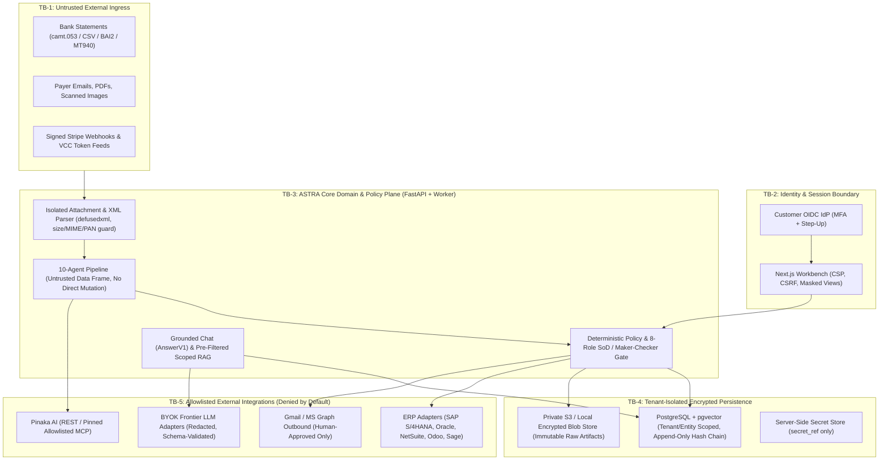

# ASTRA Threat Model, Trust Boundaries & Data Inventory (`SEC-01`, `SEC-02`)

**Document Status:** Approved for Release Candidate (`v1.0.0-rc1`)
**Independent Reviewer:** ASTRA Security Engineering

---

## 1. System Architecture & Trust Boundaries (`SEC-01`)

### Trust Boundary Threat Matrix & Mitigations

| Boundary | Threat / Attack Class | Mitigation & Enforced Control | Residual Risk & Disposition |
|---|---|---|---|
| **TB-1: Remittance & File Ingress** | XXE in `camt.053`, malicious PDF/ZIP bomb, raw credit card PAN leakage, indirect prompt injection embedded in payment notes, spoofed webhooks. | Strict size/MIME check, `defusedxml` parser, raw-PAN regex quarantine (`SEC-19`), HMAC-SHA256 timestamped webhook verification (`SEC-20`), untrusted data framing blocking instruction execution (`SEC-40`). | Low — Quarantined items require Security/Controller inspection. |
| **TB-2: Identity & Browser UI** | Session hijacking, privilege escalation, self-approval of postings/write-offs, XSS via payer remittance strings, CSV formula injection in exports. | OIDC JWT validation (`SEC-03`), MFA step-up (`SEC-04`), server-side session revocation (`SEC-05`), 8-role SoD incompatibility matrix & Maker-Checker (`SEC-06`, `SEC-09`), strict CSP & output encoding (`SEC-16`, `SEC-18`), CSV formula prefix neutralization (`SEC-29`). | Low — Tested via automated negative RBAC/SoD suite. |
| **TB-3: Agentic & AI Boundary** | Hallucinated financial totals, cross-entity RAG citation leak, model executing unauthorized SQL/HTTP/posting actions, poisoned learning loop rules. | Pre-search tenant/entity vector filtering (`SEC-41`), parameterized metric DSL + numeric consistency validator (`SEC-43`), zero write/SQL/shell tools in chat (`SEC-44`), $N=3$ confirmations + regression test + Controller approval for learning rules (`SEC-45`). | Low — AI outputs never bypass deterministic policy gate (`SEC-46`). |
| **TB-4: Ledger & Audit Persistence** | Cross-tenant data access, duplicate receipt/posting under concurrency, silent tampering with audit history, data loss. | Mandatory `(tenant_id, legal_entity_id)` predicate on every query (`SEC-07`), idempotency keys & optimistic locking (`SEC-23`, `SEC-24`), SHA-256 hash-chained append-only audit log (`SEC-27`), automated backup/restore RPO/RTO drill (`SEC-31`). | Low — Hash-chain verification runs continuously. |
| **TB-5 & TB-6: Egress & Public GitHub Repo vs. Personal AWS Sandbox** | Exposure of developer's personal AWS account IDs, ARNs, endpoints, `.tfstate`, or credentials in the public MIT repository (`pinaka-cash-apps`). | 7-layer isolation: external `../.astra-aws-sandbox/` state, no static AWS keys in app config, SSM port-forwarding (zero `0.0.0.0/0` ingress), `local-no-egress` default blocking IMDS (`169.254.169.254`), `.git/hooks/pre-commit` & `pre-push` scanners (`SEC-36`), TTL auto-expiry tags, and `ASTRA_DEMO_CAPTURE_MODE` UI hostname masking. | Negligible — Blocked at file, git hook, CI, runtime, and network layers. |

---

## 2. Data Inventory, Classification, Lineage & Retention (`SEC-02`)

| Data Asset | Classification | Source (Ingress) | Storage & Encryption (`SEC-13`) | Egress / Consumers | Retention & Legal Hold (`SEC-30`) | Accountable Owner |
|---|---|---|---|---|---|---|
| **Raw Bank Statements & Remittance Files** | Confidential Financial | Bank SFTP/API, `camt.053`, CSV, Email inbox | Immutable blob store (`SHA-256` content hash, AES-256 at rest) | Internal Reviewer UI (scoped), Audit Evidence ZIP (redacted) | 7 years default; purge blocked when `legal_hold=True` | Treasury / Controller |
| **Bank Account & Virtual-Card Token Refs** | Restricted Financial / PCI-Adjacent | Bank feed, Stripe / VCC processor token feed | PostgreSQL encrypted column; masked in UI (`•••• 4821`); raw PANs rejected at ingress | ERP posting payload (account reference only); redacted in logs (`SEC-26`) | 7 years; zero raw PAN retention | Security Admin |
| **Open AR Snapshots, Receipts & Allocations** | Confidential Financial | ERP Sync (`ARLedger`), Matching Engine | PostgreSQL (`tenant_id`, `legal_entity_id` partitioned, integer minor units) | Target ERP (`PostingIntentV1`), Treasury/FP&A Reports | 7 years | Controller |
| **Deduction Cases & Pinaka Risk Snapshots** | Confidential Operational | Deduction Agent, Pinaka AI (`RiskSnapshotV1`) | PostgreSQL (`DeductionCaseV1`, `RiskSnapshotV1` with `expires_at`) | External Deduction Workflow outbox, Short-Pay UI | 3 years (Risk snapshots expire per `expires_at`) | AR Manager |
| **Scoped RAG Chunks & Embeddings** | Confidential Operational | Normalized remittance & policy text | PostgreSQL `pgvector` with mandatory `(tenant_id, legal_entity_id)` metadata | Grounded Chat (`AnswerV1` citation verifier) | Cascade-deleted with source document (`SEC-30`) | Platform Eng |
| **Connector Credentials & OAuth Tokens** | Critical Secret | Connector Admin via Vault reference | External/Server-Side Vault (`secret_ref` pointer only in DB, `SEC-14`) | Scoped Connector HTTP/MCP client at call time; never enters LLM context | Rotated every 90 days or immediate revocation | Security Admin |
| **Append-Only Audit Trail** | Regulated Audit Record | Every state transition, approval, login, export | PostgreSQL append-only table with `prev_hash` -> `event_hash` SHA-256 chain (`SEC-27`) | Internal/External Auditor Portal & Evidence ZIP | 7+ years immutable (protected against deletion) | Internal Audit |
